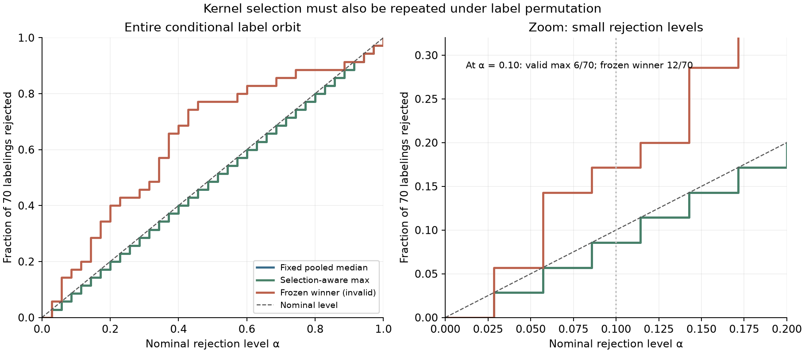
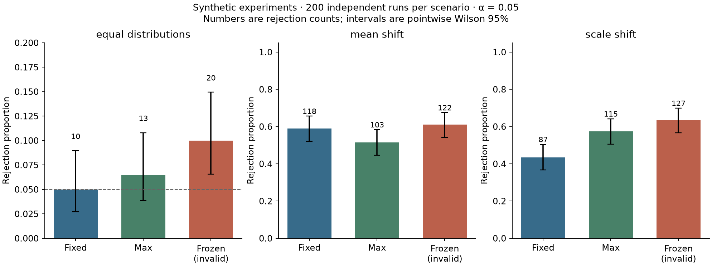

# Permutation-safe MMD

**If you search over kernel bandwidths, the permutation test must include the
search.** This small statistical-computing project implements a Gaussian-kernel
two-sample test and makes the selection mistake visible using a complete,
70-labeling example.

The project demonstrates kernel methods, conditional randomization reasoning,
vectorized numerical code, exact test oracles, and reproducible simulation.
It is an original educational implementation of established ideas, not a new
testing method or a claim of universally superior power. All demonstration data
are synthetic; no personal, proprietary, or downloaded datasets are used.

## The three procedures

| Procedure | Statistic used for every labeling | Interpretation |
| --- | --- | --- |
| Fixed pooled median | MMD² at one label-blind pooled-median bandwidth | Valid permutation reference under exchangeability |
| Selection-aware max | Maximum MMD² across the same seven bandwidths, recomputed for each labeling | Valid calibration of the entire search |
| Frozen winner **(invalid)** | Pick the largest observed MMD², then rank only that bandwidth's reference scores | Deliberately included selection-bias diagnostic; do not use for inference |

“Fixed” means the same kernel is used across labelings, not that its bandwidth
was chosen before seeing the pooled features. The grid is label-invariant.



## Reproduce

Python 3.11 or newer:

```bash
git clone https://github.com/lcx0731/permutation-safe-mmd.git
cd permutation-safe-mmd
python3 -m venv .venv
source .venv/bin/activate
python -m pip install ".[test]"
python -m pytest -W error
PYTHONWARNINGS=error mmd-selection-demo --output results
python -m pip check
```

The default demo runs 200 independent replications per scenario, 199 random
assignments per test, and the complete small label orbit. It writes:

- `results/summary.json`: configuration, all p-values, rejection counts,
  Monte Carlo standard errors, Wilson intervals, and selected-bandwidth counts.
- `results/conditional-orbit.png`: exact conditional rejection curves.
- `results/replicated-tests.png`: synthetic null and alternative experiments.

A quick smoke run is `mmd-selection-demo --replicates 4 --draws 19 --output smoke-results`.
Do not compare a smoke run to the committed default-run table.

`requirements-repro.txt` records the dependency versions used for the committed
results with Python 3.13.0. To use that environment, create a fresh Python 3.13
virtual environment, install that file, then install this package:

```bash
python -m pip install -r requirements-repro.txt
python -m pip install --no-deps .
python -m pytest -W error
PYTHONWARNINGS=error mmd-selection-demo --output reproduced-results
cmp results/summary.json reproduced-results/summary.json
```

The snapshot is not a cross-platform lockfile. The JSON is deterministic in the
recorded environment; bitwise equality across different NumPy/BLAS versions is
not promised. PNG rendering may also vary by platform. CI tests supported
dependency ranges on Python 3.11 and 3.13 and executes the full demo.

## Method

### Statistic and bandwidths

For groups of sizes $m,n\geq2$, use the Gaussian kernel
$k_h(u,v)=\exp(-\|u-v\|^2/(2h^2))$ and the statistic

$$
\widehat{\mathrm{MMD}}_h^2 =
\frac{\sum_{i\ne j} k_h(x_i,x_j)}{m(m-1)}
+\frac{\sum_{i\ne j} k_h(y_i,y_j)}{n(n-1)}
-\frac{2\sum_{i,j} k_h(x_i,y_j)}{mn}.
$$

Within-group diagonals are excluded. Estimates can be negative; the code does
not clip them or take their square root. This is the usual unbiased estimator
**for a fixed kernel**. Choosing a pooled data-dependent bandwidth or taking a
maximum does not preserve unbiasedness for a fixed population MMD target.
Permutation validity is a separate rank argument.

The base width is the median of strictly positive pairwise distances in the
pooled sample; zero distances are excluded. The grid multiplies that width by
`[0.125, 0.25, 0.5, 1, 2, 4, 8]`. No labels enter the grid, so it need not be
recomputed when labels change. If every point is identical, the base width is
1 and all three procedures return p = 1.

The selection-aware statistic is the **raw**, unstandardized maximum over
these seven scores. This is not an optimal-bandwidth algorithm, a standardized
max test, or an implementation of an aggregated-kernel method from the
literature.

### Exact versus Monte Carlo calibration

Conditional on the pooled observations under the exchangeable null, each
size-$m$ assignment is equally likely.

- **Exact mode:** enumerate all $R=\binom{m+n}{m}$ assignments once and use
  `count(T_reference >= T_observed) / R`.
- **Monte Carlo mode:** retain the observed labeling and sample $B$
  independent uniform assignments. Use
  `(1 + count(T_random >= T_observed)) / (B + 1)`.
  Sampling is with replacement across assignments; duplicates, including
  copies of the observed assignment, are retained. Within an assignment,
  indices are distinct.

Both count ties inclusively. Numerically, thresholds are lowered by
`1e-12 * max(1, maximum_absolute_statistic)` within each statistic column to
include near-ties conservatively. The resulting p-value cannot be smaller
than the corresponding strict numerical-rank p-value. With 199 random
assignments, the minimum attainable Monte Carlo p-value is 0.005.

For the max test, **every** reference labeling gets its own maximizing
bandwidth. The observed statistic and all reference statistics therefore
follow the same rule. An inclusive rank of these exchangeable statistics is
super-uniform: the null probability of p ≤ α is at most α (including
reference-sampling randomness in Monte Carlo mode). Holding an
observed-label-selected bandwidth fixed breaks that symmetry.

## An exact, finite counterexample

Use the pooled points `[-2.5, -2, -0.4, 0, 0.2, 0.8, 2, 4]`, split into two
groups of four. Treat each of the 70 assignments in turn as the observed
labeling, then calculate its exact p-value.

| Nominal level | Fixed pooled median | Selection-aware max | Frozen winner (invalid) |
| --- | --- | --- | --- |
| 0.05 | 2/70 (2.86%) | 2/70 (2.86%) | 4/70 (5.71%) |
| 0.10 | 6/70 (8.57%) | 6/70 (8.57%) | 12/70 (17.14%) |

These are complete **conditional rejection proportions**, not Monte Carlo
estimates and not population results for a particular continuous distribution.
The code checks the entire attained p-value CDF for both valid procedures,
not just these two levels. Their curves coincide in this fixture; they need
not coincide for other samples. Complementary labelings create ties in this
balanced example, so exact p-values need not be uniformly distributed.

## Independent synthetic experiments

Seed: `20261023`. Each group has 20 observations in three dimensions. The
first group is IID $N(0,I_3)$; the second is independently generated as:

- Equal distributions: $N(0,I_3)$.
- Mean shift: $N((0.9,0,0),I_3)$.
- Scale shift: $1.65Z$, $Z\sim N(0,I_3)$; equal means but different laws.

Each replication has separate deterministic random streams for data generation
and random assignments. At α = 0.05, the committed run gives:

| Scenario | Fixed pooled median | Selection-aware max | Frozen winner (invalid) |
| --- | --- | --- | --- |
| Equal distributions | 10/200 (5.0%) | 13/200 (6.5%) | 20/200 (10.0%) |
| Mean shift | 118/200 (59.0%) | 103/200 (51.5%) | 122/200 (61.0%) |
| Scale shift | 87/200 (43.5%) | 115/200 (57.5%) | 127/200 (63.5%) |



The max test's observed null rejection rate is **6.5%, not 5%**. Its pointwise
Wilson 95% interval is approximately [3.84%, 10.80%], which includes 5%.
A valid size bound does not require every finite simulation's rejection
proportion to stay below the nominal level. This run is retained as generated,
not tuned to produce a more attractive null count.

The max test has lower observed power than the fixed test for the mean shift
and higher observed power for the scale shift here. This is a descriptive,
finite-run comparison, not a claim of general superiority. A miscalibrated
method's larger rejection count is not a valid power advantage.

The plots show pointwise, approximate Wilson 95% binomial intervals across
independent replications; the JSON also includes plug-in Monte Carlo standard
errors. These are neither simultaneous intervals nor intervals for paired
differences between methods. The null plot has a different y-axis range from
the alternative plots.

## Small API example

```python
from safe_mmd import permutation_test

result = permutation_test(
    [-2.5, -2, -0.4, 0],
    [0.2, 0.8, 2, 4],
    exact=True,
)
print(result.p_fixed, result.p_max)
print(result.bandwidths)
# result.p_frozen_winner_invalid is a diagnostic, not a usable inferential p-value.
```

For larger groups, use `draws=999, seed=42` instead of `exact=True`.
Custom `bandwidths` and `fixed_index` must be set in advance or by a
label-invariant rule. The API cannot detect hidden label-dependent tuning of
the supplied grid. If you change preprocessing, feature selection, or the
search rule using labels, that whole operation must enter the randomization
procedure or be handled using a separately justified design.

Lower-level functions expose distance-based Gram matrices, assignment masks,
batched statistics, and inclusive upper-tail ranks for inspection and testing.

## Verification and boundaries

The 56 local pytest cases include:

- Independent direct-sum `Fraction` oracles for unequal group sizes, a negative
  MMD example, and checks that Gram diagonals never contribute.
- Label-order, group-complement, scaling, and batch-size invariance.
- All 70 labelings in the selection counterexample, plus enumeration of all
  $6^3$ observed/reference-label triples in a small Monte Carlo rank check.
- Constant samples, duplicate random assignments, inclusive and numerical
  ties, nonzero Monte Carlo p-values, extreme distance scales, invalid inputs,
  JSON reproducibility, figures, and a subprocess CLI smoke test.

Assumptions and limitations:

- The null is equality of **entire distributions**, not equality of means.
  Observations must be independent/exchangeable under the null.
  Unrestricted label permutation is not appropriate for paired, clustered,
  serially dependent, or adaptively collected data.
- Feature units matter. No automatic standardization, missing-data handling,
  learned representation, or dependence-aware resampling is implemented.
- Dense kernel evaluation is intended for small examples. With $K$ kernels,
  $N=m+n$ observations, and $R$ reference rows, statistic work is
  $O(KRN^2)$. Stored arrays require $O(KN^2+RN+RK)$ space, plus batch
  workspace. Distances additionally cost $O(dN^2)$ and their median sort
  costs $O(N^2\log N)$; tail sorting costs $O(KR\log R)$.
  Exact enumeration is capped at 50,000 assignments before
  allocation; this cap is not a universal memory guarantee.
- Symmetry and finite arithmetic are checked for supplied Gram matrices;
  positive semidefiniteness is not. A valid kernel is needed for the MMD
  interpretation. The built-in RBF construction supplies one.
- Near-tie tolerance may reduce power for tiny statistic differences.
  The max uses no variance normalization and only a finite, specified grid.
- This is an educational portfolio project, not a production drift-monitoring
  service or a validated procedure for repeated, ongoing monitoring.

## References

- Gretton et al. (2012), [A Kernel Two-Sample Test](https://www.jmlr.org/papers/v13/gretton12a.html):
  background on MMD and kernel two-sample testing.
- Phipson and Smyth (2010),
  [Permutation P-values Should Never Be Zero](https://pubmed.ncbi.nlm.nih.gov/21044043/):
  background on nonzero Monte Carlo permutation p-values.

The code, finite fixture, experiments, and explanatory comparison in this
repository were written for this project. No reference implementation was
copied. Licensed under the [MIT License](LICENSE).
